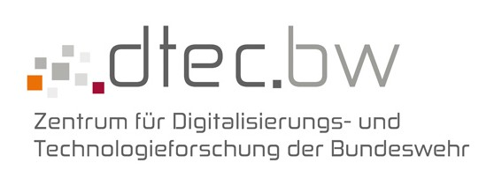

<div align="center">

# Loshifacer

### A simple tool to ingest OSH data in zenflows

</div>

<p align="center">
  <a href="https://dyne.org">
    
  </a>
</p>

## Building the digital infrastructure for Fab Cities

<br>
<a href="https://www.interfacerproject.eu/">
  
</a>
<br>

### What is **INTERFACER?**

The goal of the INTERFACER project is to build the open-source digital infrastructure for Fab Cities.

Our vision is to promote a green, resilient, and digitally-based mode of production and consumption that enables the greatest possible sovereignty, empowerment and participation of citizens all over the world.
We want to help Fab Cities to produce everything they consume by 2054 on the basis of collaboratively developed and globally shared data in the commons.

To know more [DOWNLOAD THE WHITEPAPER](https://www.interfacerproject.eu/assets/news/whitepaper/IF-WhitePaper_DigitalInfrastructureForFabCities.pdf)

## Loshifacer Features

* Use a large dataset of [OSH information](https://gitlab.opensourceecology.de/verein/projekte/losh-rdf.git)
* Analize all the git repository with the [osh-toll](https://github.com/hoijui/osh-tool)
* Secure communication with zenflows by using [zenflows-crypto](https://github.com/interfacerproject/zenflows-crypto)

<br>

<div id="toc">

### 🚩 Table of Contents

- [💾 Install](#-install)
- [🎮 Quick start](#-quick-start)
- [🐋 Docker](#-docker)
- [😍 Acknowledgements](#-acknowledgements)
- [🌐 Links](#-links)
- [👤 Contributing](#-contributing)
- [💼 License](#-license)

</div>

***
## 💾 Install

- Clone [losh-rdf](https://gitlab.opensourceecology.de/verein/projekte/losh-rdf.git) on the machine.
- Install [osh-toll](https://github.com/hoijui/osh-tool) in the main root of this repository and [projvar](https://github.com/hoijui/projvar) in a folder inside you PATH.
- Modify .env.exmaple such that:
    * PATH_TO_RDF points to the losh-rdf folder
    * URL points to the web-page you want to ingest in
    * USERNAME, AGENT and EDDSA are your personal information
    * LOCATIONID is the location-id of the resources

Now you can simply start the ingestion using the following command:
```
# install dependencies
poetry install

# enviromantal variable
cp .env.example .env

# to perform a total ingestion
poetry run ingestion
# to perform a ingestion of new files in losh-rdf
poetry run cronjob
```

**[🔝 back to top](#toc)**

***
## 🎮 Quick start

To start using Loshifacer run the following command in the root folder

```bash
docker compose up
```

**[🔝 back to top](#toc)**

***
## 🐋 Docker

Please refer to [DOCKER PACKAGES](../../packages)


**[🔝 back to top](#toc)**

***

## 😍 Acknowledgements

### Funding

#### October 2021 – March 2023

This project was funded by the European Regional Development Fund (ERDF) as part of the INTERFACER project.


#### January 2025 – December 2026

The further development of this project was supported as part of the "Fab City – Decentralized Digital Production for Urban Value Creation" project, funded by dtec.bw and supported by the European Union – NextGenerationEU.

<p>
  
  
</p>


<a href="https://dyne.org">
  
</a>

Copyleft (ɔ) 2022 by [Dyne.org](https://www.dyne.org) foundation, Amsterdam

Designed, written and maintained by Puria Nafisi Azizi and Matteo Cristino.

**[🔝 back to top](#toc)**

***
## 🌐 Links

https://www.interfacer.eu/

https://dyne.org/

**[🔝 back to top](#toc)**

***
## 👤 Contributing

1.  🔀 [FORK IT](../../fork)
2.  Create your feature branch `git checkout -b feature/branch`
3.  Commit your changes `git commit -am 'Add some fooBar'`
4.  Push to the branch `git push origin feature/branch`
5.  Create a new Pull Request
6.  🙏 Thank you


**[🔝 back to top](#toc)**

***
## 💼 License
    Loshifacer - A simple tool to ingest OSH data in zenflows
    Copyleft (ɔ) 2022 Dyne.org foundation

    This program is free software: you can redistribute it and/or modify
    it under the terms of the GNU Affero General Public License as
    published by the Free Software Foundation, either version 3 of the
    License, or (at your option) any later version.

    This program is distributed in the hope that it will be useful,
    but WITHOUT ANY WARRANTY; without even the implied warranty of
    MERCHANTABILITY or FITNESS FOR A PARTICULAR PURPOSE.  See the
    GNU Affero General Public License for more details.

    You should have received a copy of the GNU Affero General Public License
    along with this program.  If not, see <http://www.gnu.org/licenses/>.

**[🔝 back to top](#toc)**
